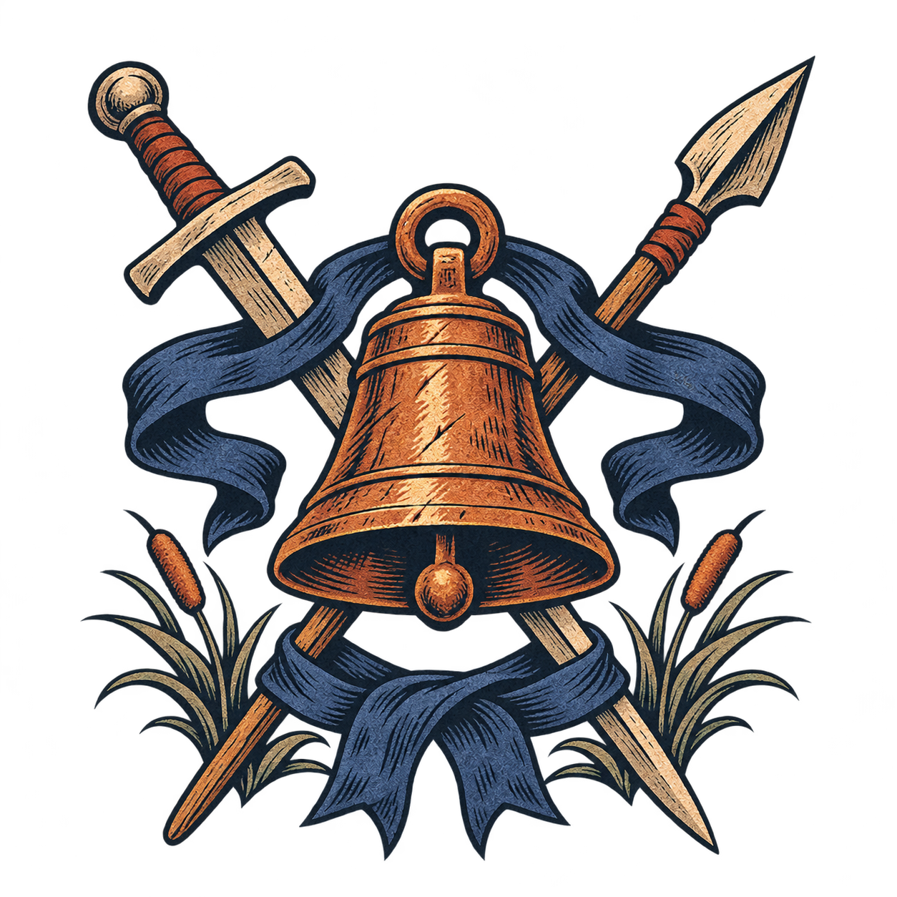
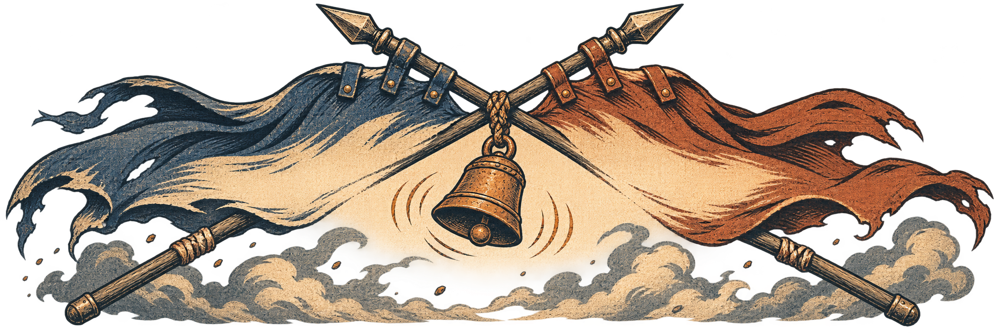
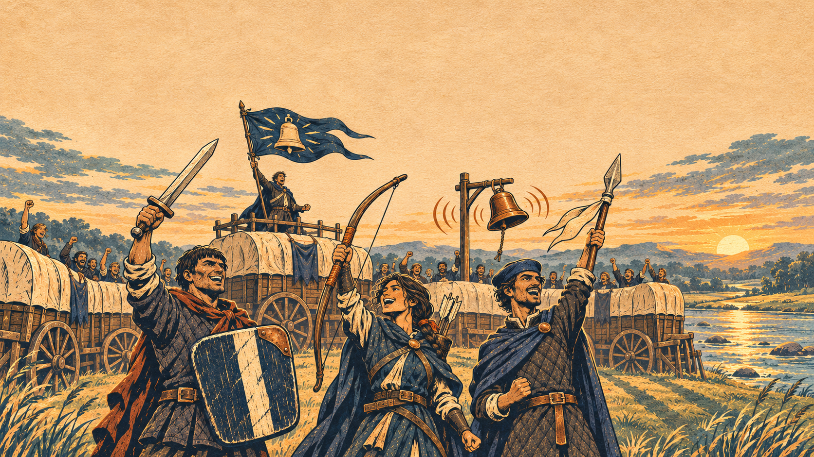
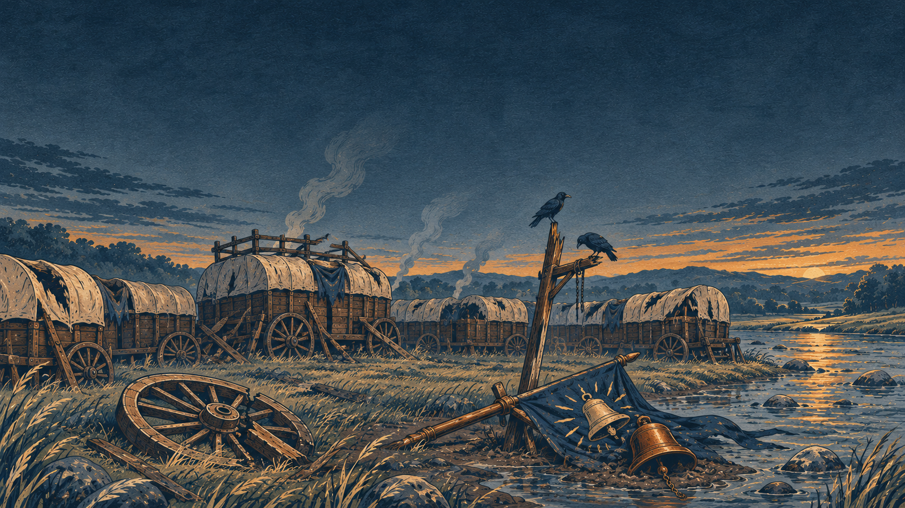
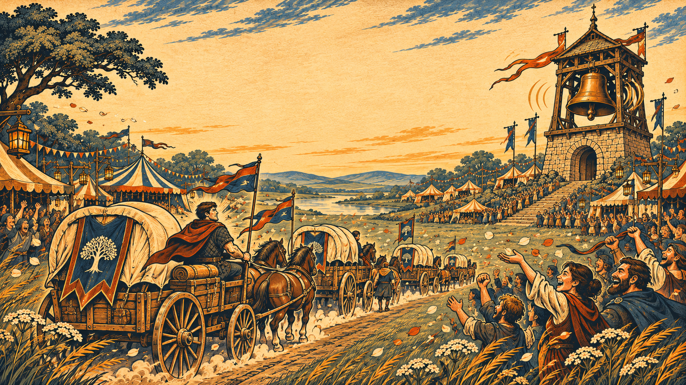
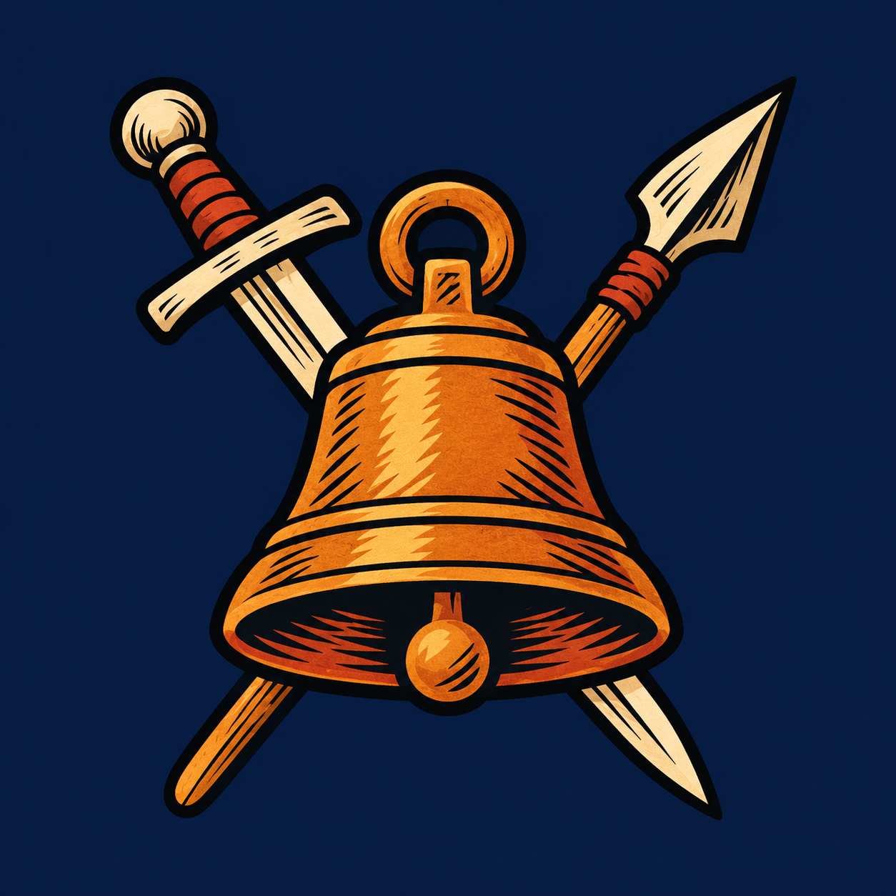

# UI art batch 01 — approval review

Six new raw source PNGs generated on 28 November 2026 from the Art section of [the supplied brief](MUSIC-SFX-ART-PROMPTS.md). The exact generation prompts and reference roles are in [PROMPTS-UI-01.md](PROMPTS-UI-01.md). Owner approval is pending.

## Files

| Filename | Use | Delivered raw pixels | Brief export target | Background |
| --- | --- | --- | --- | --- |
| `ui_crest.png` | Title/loading crest | 1254×1254 | 1024×1024 | RGBA / transparent |
| `ui_battle_start.png` | Battle-start sweep | 2172×724 | 2400×800 | RGBA / transparent |
| `ui_victory.png` | Battle victory | 1672×941 | 2560×1440 | RGB / opaque |
| `ui_defeat.png` | Battle defeat | 1672×941 | 2560×1440 | RGB / opaque |
| `ui_march_won.png` | Campaign victory at Fifth Bell | 1672×941 | 2560×1440 | RGB / opaque |
| `icon.png` | App/browser icon source | 1254×1254 | 1024×1024 | RGB / opaque |

The generator returned the native dimensions above despite the requested target sizes. These source files are deliberately unresized and uncropped, following the brief's instruction to upload raw files. The scene images are approximately 16:9; the banner is exactly 3:1. Exact-size production exports remain for the integration pass. Upscaling a scene to 2560×1440 would not add genuine source detail; regenerate at a higher native resolution if that detail is required.

## Visual review

- Matched the existing `sword1.png` woodcut palette, outlines and carved hatching throughout.
- Victory uses `sword1.png`, `bow1.png` and `spear1.png` as character references: striped shield and rust scarf, dark braided archer, blue-capped spearman.
- Defeat uses the victory scene as a location reference: the same river meadow and wagon ring, abandoned with fallen banner and bell; no bodies or people.
- Fifth Bell uses the existing `fifth_bell.webp` battlefield as a location reference, preserving the stone-base timber belfry and river fair.
- Crest and banner have genuine alpha transparency. Scene backgrounds and icon are opaque. The icon simplifies the crest to the bell and crossed weapons.
- No generated text, stat panels, borders or watermarks. Scenes reserve calm upper sky; the Fifth Bell tower occupies the right side.
- Final acceptance should include the banner over the game's board and text, the icon at 48 px, and scene typography/crops at the intended mobile layout.

## Scope and validation

This PR supplies source artwork and review documentation. The brief assigns conversion, UI animations and app-icon installation to the later integration pass. No runtime asset references or gameplay code are changed. Music and SFX are outside this image-generation request.

- All six PNG files decode successfully and have the exact requested filenames.
- Alpha/opaque background modes verified; sizes, file sizes and SHA-256 hashes recorded in [ui-art-manifest.json](ui-art-manifest.json).
- `npm test`: 28 tests passed.
- `npx tsc --noEmit`: passed.
- `npm run build`: passed.
- Existing desktop (1280×720) and mobile (844×390) march playtests were attempted but blocked before loading the game: the installed `/usr/bin/chromium` launcher points to a missing `/usr/lib/chromium/chromium` executable. No browser playtest pass is claimed.

## Preview gallery

### Title/loading crest — `ui_crest.png`

### Battle-start sweep — `ui_battle_start.png`

### Battle victory — `ui_victory.png`

### Battle defeat — `ui_defeat.png`

### Campaign victory at Fifth Bell — `ui_march_won.png`

### App/browser icon source — `icon.png`

